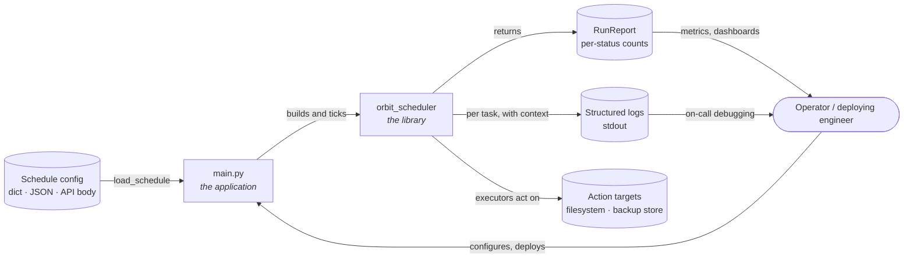
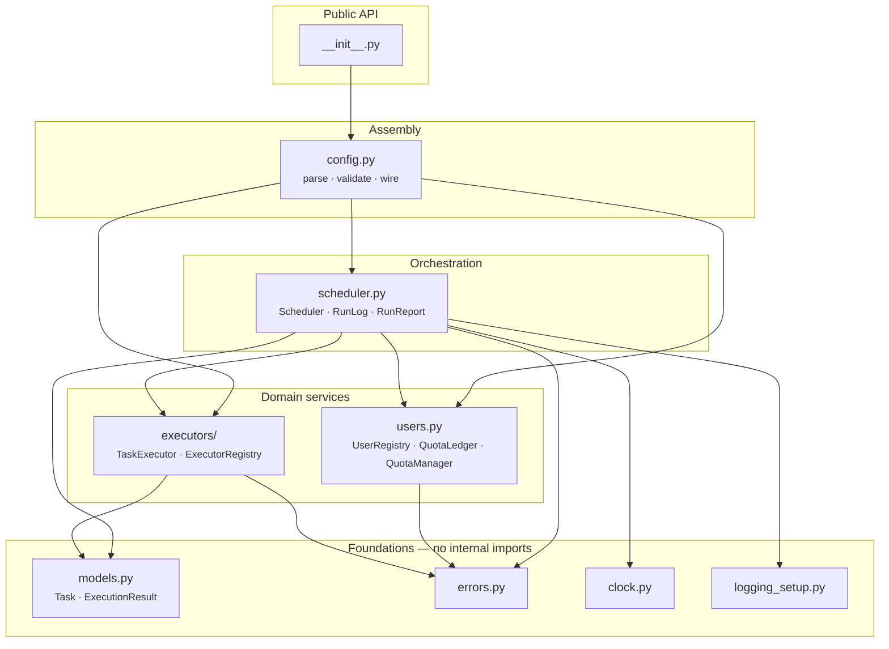
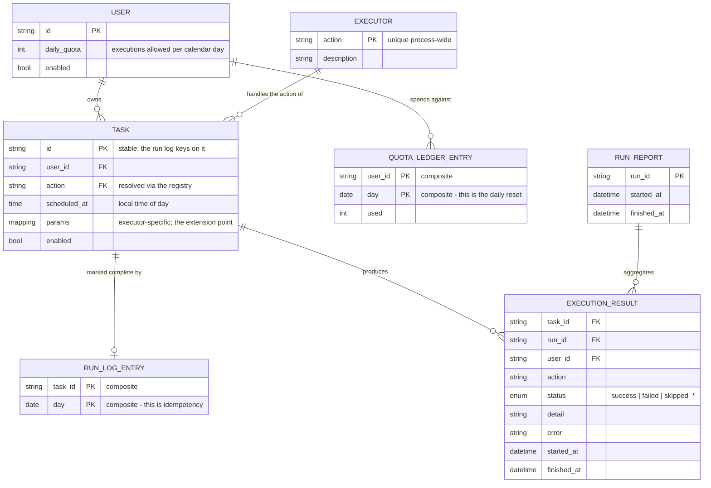
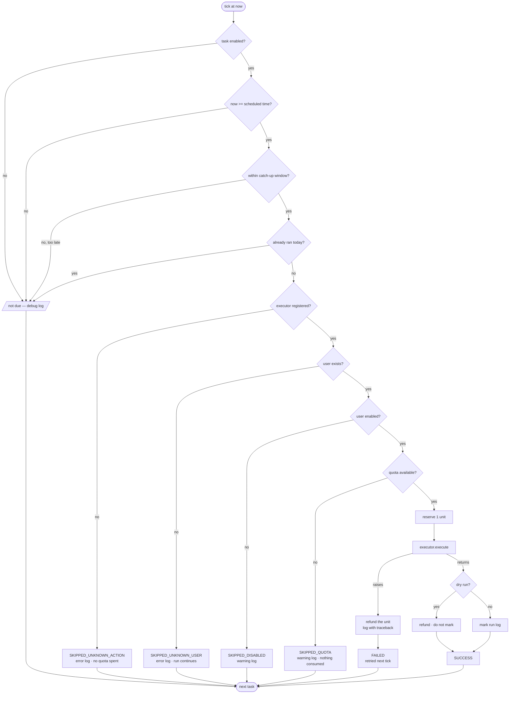
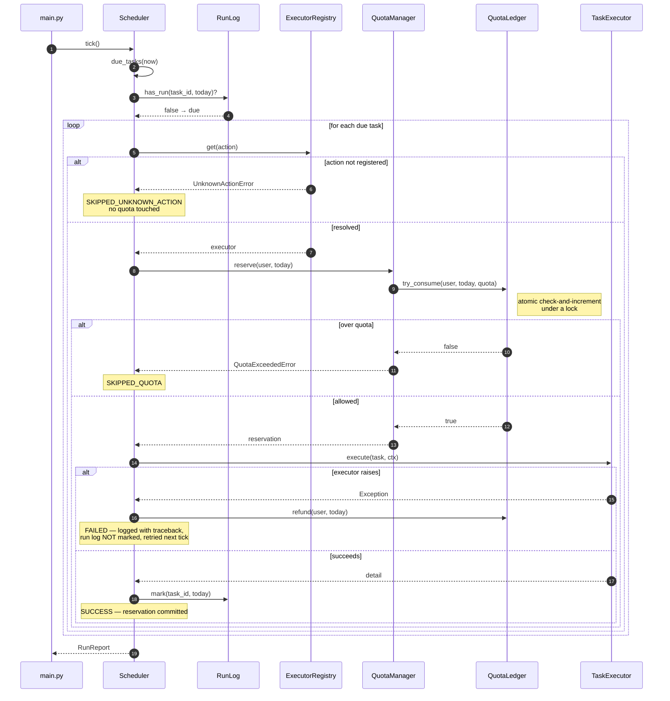
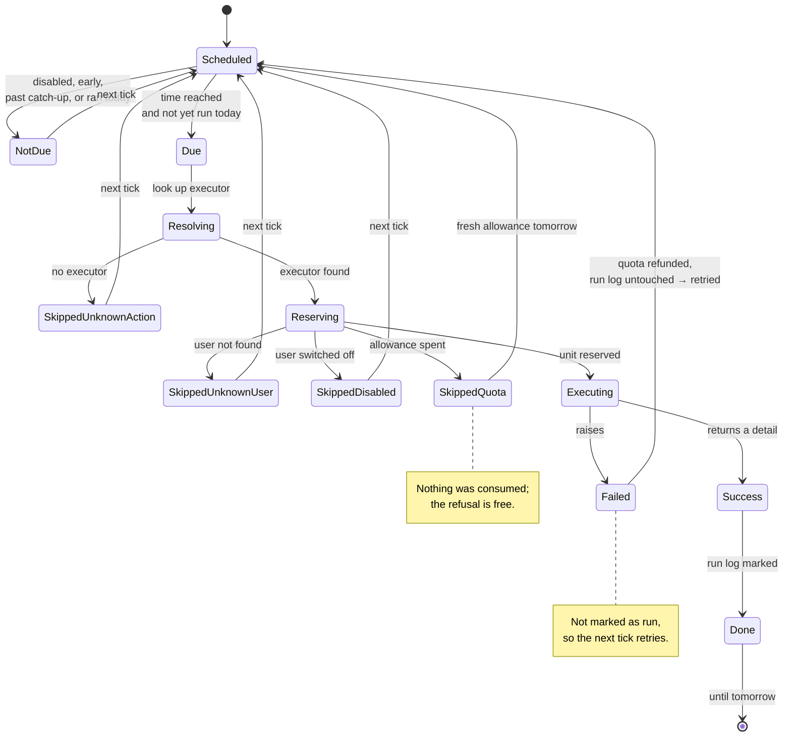
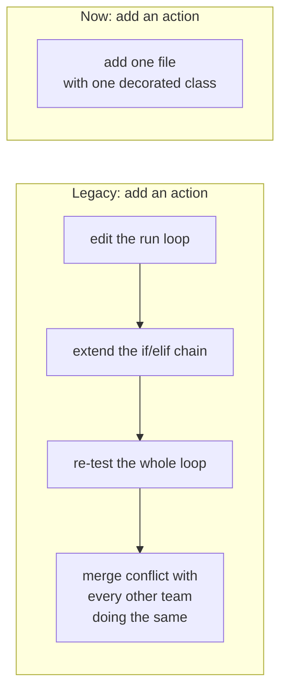

# Architecture

Reference for the ORBIT task scheduler: module boundaries, the data model, and the flow
of one scheduling tick. Written for a reviewer signing this off and for the next engineer
who has to change it.

Diagrams are Mermaid, so they render in GitHub, Notion, VS Code and most review tools.

- [1. System context](#1-system-context)
- [2. Module structure](#2-module-structure)
- [3. Entity relationship diagram](#3-entity-relationship-diagram)
- [4. Execution flow](#4-execution-flow)
- [5. Sequence of one tick](#5-sequence-of-one-tick)
- [6. Task lifecycle](#6-task-lifecycle)
- [7. Extension points](#7-extension-points)
- [8. Concurrency and state](#8-concurrency-and-state)
- [9. Where to change what](#9-where-to-change-what)

---

## 1. System context

The library never configures logging, never reads a file on its own and never calls
`datetime.now()` outside an injected clock. Everything ambient is the application's
decision, which is what keeps the library embeddable in a web server, a worker or a test.

---

## 2. Module structure

Dependencies all point **inward**. `models`, `errors`, `clock` and `logging_setup` import
nothing from the package, so they can be read — or lifted out — on their own. The graph
is acyclic; this diagram is generated from the real imports, not an aspiration.

| Layer | Modules | Rule |
|---|---|---|
| **L0 Foundations** | `models`, `errors`, `clock`, `logging_setup` | Import nothing internal. Safe to extract for other teams. |
| **L1 Domain services** | `users`, `executors` | Know the data model. Know nothing about scheduling. |
| **L2 Orchestration** | `scheduler` | Knows L0 and L1. Owns *when* and *whether*, never *how*. |
| **L3 Assembly** | `config` | Turns untrusted input into validated objects and wires them together. |
| **L4 Public API** | `__init__` | A curated re-export. A convenience, not a fence. |

The four modules the brief names map onto `models.py` (task data model), `users.py` (user
management and quota control), `executors/base.py` (extensible executor) and
`scheduler.py` (scheduling system).

---

## 3. Entity relationship diagram

The service is in-memory, but the entities and their keys are modelled as if they were
persisted — because they shortly will be, and because **two composite keys carry the two
most important correctness properties in the system**.

### The two composite keys are the design

Everything else in this document is organisation. These two are correctness.

| Entity | Key | Property it guarantees | Legacy equivalent |
|---|---|---|---|
| `QUOTA_LEDGER_ENTRY` | **(user_id, day)** | The daily reset happens by construction. A new day is a new row, so yesterday's usage stops counting without anything running at midnight. | `users[u]['executed']` — a single counter that only grew, making a daily quota a lifetime one. |
| `RUN_LOG_ENTRY` | **(task_id, day)** | A tick is idempotent. The second tick inside the scheduled minute finds the row and does nothing. | None. `task['time'] == now` re-fired on every tick in that minute. |

Both map directly onto their scaled form: `(user_id, day)` becomes a Redis key
`quota:{user}:{date}` with a day-length TTL; `(task_id, day)` becomes a unique database
constraint that turns a double-dispatch into a no-op.

### Cardinality notes

- `USER ||--o{ TASK` — one user, many tasks, **including several at the same time**. This
  is the brief's "a single user can have multiple tasks simultaneously"; it needs no
  special handling because quota is checked per execution, not per user per tick.
- `TASK ||--o| RUN_LOG_ENTRY` — at most one per day. That *is* the idempotency guarantee.
- `TASK ||--o{ EXECUTION_RESULT` — many over time, including repeated failures. A result
  is written for every attempt; the run-log row only for a success.
- `EXECUTOR ||--o{ TASK` — an action is claimed process-wide, so two teams cannot both
  ship a `backup`. The collision raises at import time.

---

## 4. Execution flow

The gates one task passes through, in order. The ordering is deliberate: **the executor
is resolved before quota is consumed**, so a mistyped action costs the user nothing.

Every terminal state leads to `next task`. **No path exits the loop**, which is the fix
for the legacy `KeyError` that silently stopped every task after the first bad one.

Note the asymmetry between the two failure terminals: `FAILED` does *not* mark the run
log, so the task is retried on the next tick; `SUCCESS` does, so it is not.

---

## 5. Sequence of one tick

The refund in the failure branch is not written at the call site — `QuotaManager.reserve`
is a context manager that refunds on its way out of an exception. The scheduler cannot
forget to do it, and neither can the next person who adds a branch.

---

## 6. Task lifecycle

One task, across one tick.

Every non-terminal state returns to `Scheduled`, so no outcome is permanently absorbing
within a day — a correctness property the legacy code lacked, where a `KeyError` ended
the run and a late tick lost the task for good.

---

## 7. Extension points

Each of these is a seam that was put there on purpose. Using one should require **no edit
to the scheduling core**.

| Seam | Type | Swap in | Why it exists |
|---|---|---|---|
| `TaskExecutor` + `ExecutorRegistry` | ABC + registry | A new action class | The brief's "extensible executor". Dispatch is a dict lookup, never an `if/elif`. |
| `RunLog` | `Protocol` | Postgres / Redis implementation | Survives restarts; a unique `(task_id, day)` index gives exactly-once at scale. |
| `Clock` | `Protocol` | `FrozenClock`, a timezone-aware clock | Deterministic tests; per-user timezones later. |
| `QuotaLedger` | class behind `QuotaManager` | Redis `INCR` with a day TTL | Race-free quota across many workers. |
| `Task.params` | open mapping | Any executor-specific keys | New parameters need no change to the model, scheduler or config loader. |
| `ExecutionContext` | frozen dataclass | Add a field | New ambient capabilities (trace id, cancellation, metrics) reach every executor without changing a single signature. |
| `configure_logging` | application hook | JSON formatter, shipper | The library emits records; the application decides where they go. |

### What the registry buys, concretely

`tests/test_executors.py::test_a_new_action_needs_no_change_to_the_system` asserts the
right-hand box from outside the package, so the claim is enforced rather than promised.

---

## 8. Concurrency and state

The service is single-process today, but the mutable state is already guarded, because
retrofitting locks onto shared counters after the fact is where race conditions come from.

| State | Owner | Guard | Grows by |
|---|---|---|---|
| Quota counts | `QuotaLedger` | `threading.Lock`; `try_consume` is one atomic **check-and-increment** | one entry per user per day |
| Run-log entries | `InMemoryRunLog` | `threading.Lock` | one entry per executed task per day |
| Task list | `Scheduler` | `threading.Lock` on add/remove/read | one entry per task |
| `Task`, `ExecutionResult`, `ExecutionContext` | — | **immutable** (`frozen=True`); `params` is a `MappingProxyType` | — |

Two details worth a reviewer's attention:

**`try_consume` is atomic on purpose.** Checking the limit and then incrementing as two
steps lets two threads both pass the check and jointly exceed the quota. The single
locked operation is what makes the limit a limit.

**Both in-memory stores grow without bound** in a long-running process — one entry per
user (or task) per day. `Scheduler.purge_history(before=...)` drops old entries; a
persistent backend would use a TTL instead. Called daily, memory stays flat.

---

## 9. Where to change what

The lookup table for somebody new to the codebase.

| I want to… | Change | Do **not** touch |
|---|---|---|
| Add a task type | A new `TaskExecutor` subclass in its own module | `scheduler.py`, `models.py`, `config.py` |
| Add a parameter to an existing action | That executor's `validate_params` and `execute` | `Task` — `params` is already open |
| Change what counts as a valid path | `PathTaskExecutor.validate_params` (one place, all three built-ins) | the individual executors |
| Change how much a user may run | Config, or `User.daily_quota` | the ledger — it only counts |
| Change *when* quota resets | `QuotaLedger`'s key, currently `(user_id, date)` | everything else — it is the only place the period is defined |
| Persist run state across restarts | Implement `RunLog`, pass it to `Scheduler` | `scheduler.py` |
| Support weekly or cron schedules | `Task.scheduled_at` and `Scheduler.due_tasks` | executors, quota, config validation |
| Change log destination or format | `configure_logging` in `logging_setup.py` | any library module — none of them configure logging |
| Add a field to every log line | `TaskLogAdapter`, or `.bind()` at the call site | individual log calls |
| Add a new failure outcome | `ExecutionStatus` and one `except` in `_execute_one` | the executors |
| Validate config more strictly | `config.py::_validate_task`, or an executor's `validate_params` | the scheduler — it trusts validated input |
